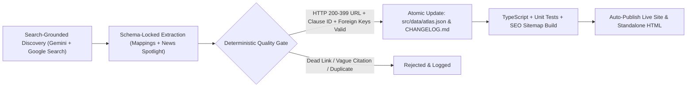

# Open Atlas of AI Governance Interoperability

> **Live Web Application (No GitHub, Installation, or Login Required)**
>
> **[Open Interactive Observatory → https://lihui-aigov.github.io/interoperability-atlas/](https://lihui-aigov.github.io/interoperability-atlas/)**
>
> Explore breaking in-the-news AI governance spotlights, a 9-by-9 cross-regime convergence heatmap, interactive compliance flows, verified clause excerpts, and downloadable procurement checklists directly in any browser.

[](https://github.com/lihui-aigov/interoperability-atlas/actions/workflows/ci-verify-and-deploy.yml)
[](https://github.com/lihui-aigov/interoperability-atlas/actions/workflows/autonomous-curator.yml)

---

## Why This Exists (Personal Origin & Institutional Neutrality)

I started this project for practical day-to-day use while following fast-moving AI governance news and regulatory debates across jurisdictions. Whenever a new enforcement action, agentic AI deployment, or public procurement controversy appeared, I wanted a fast way to check what existing global instruments actually imply for that concrete scenario, where regimes share operational controls, and where cross-border interoperability breaks down. Existing trackers mostly list legal documents side by side without connecting them to real deployments or engineering artifacts, so I built this tool for myself and opened it for anyone facing the same questions.

Lihui Xu ([@lihui-aigov](https://github.com/lihui-aigov)) maintains this repository independently in a personal capacity. Every mapping, commentary point, and verification step draws exclusively from publicly enacted statutes, multilateral recommendations, official guidelines, and published standards. Nothing in this codebase or dataset represents official positions of UNESCO or any Member State.

---

## Methodological Thesis: Anchoring Crosswalks in Concrete Deployments

Conventional regulatory crosswalks compare legal instruments side by side in the abstract. That approach helps scholars spot textual overlap, yet it leaves policymakers, procurement officers, and engineering teams guessing on Monday morning when they need evidence-backed arguments for a specific news event or live system procurement.

Every record in this Atlas instead anchors on a three-part operational tuple linking a concrete AI deployment (`useCaseId`) to an observable verification artifact (`controlId`) and an authoritative provision (`instrumentId`). Each edge classifies the cross-regime relationship into one of three categories:

| Alignment Class | Operational Meaning | Action Required by Policy & Engineering Teams |
| :--- | :--- | :--- |
| **Equivalent Core** (`equivalent`) | Shared operational control satisfies multiple governance instruments concurrently. | Build and audit one canonical artifact (`Comply Once, Verify Across`). |
| **Jurisdictional Delta** (`delta`) | Supplemental statutory filing, local cohort check, or workflow step beyond baseline standards. | Layer targeted procedural documentation onto the shared baseline control. |
| **Interoperability Friction** (`friction`) | Conflicting statutory prohibition, disclosure timing clash, or irreconcilable data duty. | Escalate to legal and policy counsel for architectural fencing or scope carve-out. |

As of dataset version 2026.11.6, `src/data/atlas.json` tracks 3 real-world news spotlights, 11 concrete AI use cases, 8 operational controls, 9 global and regional instruments, and 119 verified clause-level mappings.

---

## Tracked Governance Corpus (9 Instruments)

| Instrument | Scope / Jurisdiction | Legal Nature | Adoption | Primary Authoritative Reference |
| :--- | :--- | :--- | :---: | :--- |
| UNESCO Recommendation on the Ethics of AI | Global Multilateral | Multilateral Norm | 2021 | [UNESCO Portal](https://www.unesco.org/en/artificial-intelligence/recommendation-ethics) |
| EU Artificial Intelligence Act (Reg. 2024/1689) | European Union | Binding Regulation | 2024 | [EUR-Lex](https://eur-lex.europa.eu/eli/reg/2024/1689/oj) |
| Council of Europe Framework Convention on AI (CETS No. 225) | International Treaty | Binding Regulation | 2024 | [Council of Europe](https://www.coe.int/en/web/artificial-intelligence/the-framework-convention-on-artificial-intelligence) |
| ISO/IEC 42001 AI Management System Standard | International Standard | Certifiable Standard | 2023 | [ISO 81230](https://www.iso.org/standard/81230.html) |
| NIST AI Risk Management Framework (AI RMF 1.0) | United States / Global Benchmark | Voluntary Risk Framework | 2023 | [NIST ITL](https://www.nist.gov/itl/ai-risk-management-framework) |
| Singapore Model AI Governance Framework for Agentic AI | Singapore / ASEAN Reference | Voluntary Risk Framework | 2026 | [AI Verify Foundation](https://aiverifyfoundation.sg/) |
| ASEAN Guide on AI Governance and Ethics (& Expanded GenAI Guide) | Southeast Asia (10 Member States) | Voluntary Risk Framework | 2024 | [ASEAN Portal](https://asean.org/) |
| African Union Continental AI Strategy | Pan-African Continental | Continental Strategy | 2024 | [African Union](https://au.int/en/documents/20240809/continental-artificial-intelligence-strategy) |
| Brazil AI Bill (PL 2338/2023) & South Korea AI Basic Act | Major G20 Statutory Regimes | Binding Regulation | 2025 | [Senado Federal](https://www25.senado.leg.br/web/atividade/materias/-/materia/157233) |

> **Normative Texts vs. Implementation Tools:** The instruments table tracks formal normative texts, binding statutes, and consensus standards. Operational assessment tools built *on top* of those texts—such as UNESCO's 2023 Ethical Impact Assessment (EIA) methodology implementing Policy Action Area 1 (`§§50–53`) of the 2021 Recommendation—belong to the Operational Controls and Verification Artifacts layer rather than being merged into the 2021 normative instrument.

---

## Six Complementary Views Inside the Web Application

1. **In-the-News Governance Spotlight (`00-top`):** Translates current AI deployments and regulatory developments into ready-to-cite arguments across five jurisdictional lenses (`Global / Multilateral`, `European Union`, `Asia-Pacific & ASEAN`, `Africa & LATAM`, `Standards & US`), pinpointing the interoperability bottleneck and engineering control required.
2. **Cross-Regime Convergence Map (`00`):** Compares obligation composition across all nine instruments alongside an interactive N-by-N pairwise convergence heatmap (`computePairwiseRegimeMatrix`) highlighting co-mapped equivalent controls and statutory friction clashes.
3. **Multi-Port Alluvial Topology (`01`):** Renders three synchronized columns (Concrete Use Cases, Operational Controls, Global Instruments) with sector filters, subgraph focus mode, multi-port cubic ribbons, and clickable pathway inspection.
4. **80/20 Brief & In-App Clause Reader:** Summarizes high-leverage shared controls for any selected entity and opens clause excerpts, section anchors, and engineering verification steps inline.
5. **Sticky Crosswalk Matrix & Procurement Export (`02`):** Compares all instruments against every control with sticky row headers and generates downloadable Markdown procurement checklists or JSON schema patches.
6. **Triple-Mode Scenario Workbench (`03`):** Runs pre-verified simulation presets offline with zero keys, calls an Express server backend (`/api/atlas/map-use-case`) on Cloud Run, or uses a session-scoped browser key to synthesize custom scenarios directly via the Gemini REST API.

---

## Autonomous Curation, Verification & Organic Publishing Pipeline

Scheduled workflows under `.github/workflows/autonomous-curator.yml` run twice weekly (Mondays and Thursdays at 07:00 UTC), executing `scripts/curate-atlas.mjs` against strict TypeScript interfaces (`src/types/atlas.ts`).



No candidate mapping or news spotlight enters `src/data/atlas.json` unless `runDeterministicQualityGate` verifies live HTTP 200-399 reachability on primary URLs, checks non-generic citations, validates foreign keys, and prevents duplication. Every verified update automatically triggers `scripts/inject-seo-and-sitemap.mjs` to emit crawlable static landing pages (`/spotlights/*.html`, `/use-cases/*.html`), `sitemap.xml`, `robots.txt`, `llms.txt`, and Schema.org `Dataset` JSON-LD before republishing [https://lihui-aigov.github.io/interoperability-atlas/](https://lihui-aigov.github.io/interoperability-atlas/).

---

## Running Locally or Packaging Standalone

```bash
npm install
npm run lint && npm test
npm run build:standalone
GEMINI_API_KEY="your-key" npm start
```

Running `npm run build:standalone` generates both the SEO-indexed web distribution under `dist/` and a portable single-file offline HTML bundle at `dist-standalone/open-atlas-interactive.html`.

---

## Citing This Work

Formal machine-readable citation metadata lives in [`CITATION.cff`](CITATION.cff).

```bibtex
@software{xu_2026_interoperability_atlas,
  author       = {Xu, Lihui},
  title        = {{Open Atlas of AI Governance Interoperability}},
  year         = {2026},
  version      = {2026.11.6},
  url          = {https://lihui-aigov.github.io/interoperability-atlas/}
}
```

## License

Software source code is licensed under the [MIT License](LICENSE). Structured governance mappings, news spotlight syntheses, and methodology documentation (`src/data/atlas.json`) carry a Creative Commons Attribution 4.0 International (CC-BY-4.0) license. See [`CONTRIBUTING.md`](CONTRIBUTING.md) for evidentiary rules when submitting updates.
