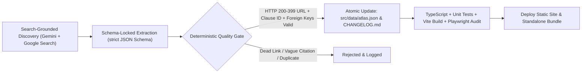

# Open Atlas of AI Governance Interoperability

**Use-case-anchored operational mapping across multilateral norms, statutory AI regulations, technical management standards, and regional frameworks.**

[](https://github.com/lihui-aigov/interoperability-atlas/actions/workflows/ci-verify-and-deploy.yml)
[](https://github.com/lihui-aigov/interoperability-atlas/actions/workflows/autonomous-curator.yml)

---

## Institutional Neutrality & Personal Capacity

Lihui Xu ([@lihui-aigov](https://github.com/lihui-aigov)) maintains this repository independently in a personal scholarly capacity. Every mapping, rationale, and verification step draws solely from publicly enacted statutes, published multilateral recommendations, official government guidelines, and technical standards texts. Nothing in this codebase or dataset represents official positions of UNESCO or any Member State.

---

## Methodological Thesis: Anchoring Crosswalks in Concrete Deployments

Conventional regulatory crosswalks compare legal instruments side by side in the abstract. That approach helps legal scholars spot textual overlap, yet it fails procurement teams, regulators, and system engineers on Monday morning when a ministry asks what concrete vendor evidence is needed to deploy a specific system lawfully across jurisdictions.

Every record in this Atlas instead anchors on a three-part operational tuple linking a concrete AI deployment (`useCaseId`) to an observable technical or institutional verification artifact (`controlId`) and an authoritative provision (`instrumentId`). Each edge classifies the cross-regime relationship into one of three categories:

| Alignment Class | Operational Meaning | Action Required by Engineering & Procurement Teams |
| :--- | :--- | :--- |
| **Equivalent Core** (`equivalent`) | Shared operational control satisfies multiple governance instruments concurrently. | Build and audit one canonical artifact (`Comply Once, Verify Across`). |
| **Jurisdictional Delta** (`delta`) | Supplemental statutory filing, local cohort check, or workflow step beyond baseline standards. | Layer targeted procedural documentation onto the shared baseline control. |
| **Interoperability Friction** (`friction`) | Conflicting statutory prohibition, disclosure timing clash, or irreconcilable data duty. | Escalate to legal and policy counsel for architectural fencing or scope carve-out. |

As of dataset version 2026.11.6, `src/data/atlas.json` contains 11 concrete AI use cases, 8 operational controls, 9 global and regional instruments, and 119 verified clause-level mappings.

---

## Tracked Governance Corpus (9 Instruments)

| Instrument | Scope / Jurisdiction | Legal Nature | Adoption | Primary Authoritative Reference |
| :--- | :--- | :--- | :---: | :--- |
| UNESCO Recommendation on the Ethics of AI & Ethical Impact Assessment (EIA) | Global Multilateral | Multilateral Norm | 2021 | [UNESCO Portal](https://www.unesco.org/en/artificial-intelligence/recommendation-ethics) |
| EU Artificial Intelligence Act (Reg. 2024/1689) | European Union | Binding Regulation | 2024 | [EUR-Lex](https://eur-lex.europa.eu/eli/reg/2024/1689/oj) |
| Council of Europe Framework Convention on AI (CETS No. 225) | International Treaty | Binding Regulation | 2024 | [Council of Europe](https://www.coe.int/en/web/artificial-intelligence/the-framework-convention-on-artificial-intelligence) |
| ISO/IEC 42001 AI Management System Standard | International Standard | Certifiable Standard | 2023 | [ISO 81230](https://www.iso.org/standard/81230.html) |
| NIST AI Risk Management Framework (AI RMF 1.0) | United States / Global Benchmark | Voluntary Risk Framework | 2023 | [NIST ITL](https://www.nist.gov/itl/ai-risk-management-framework) |
| Singapore Model AI Governance Framework for Agentic AI | Singapore / ASEAN Reference | Voluntary Risk Framework | 2026 | [AI Verify Foundation](https://aiverifyfoundation.sg/) |
| ASEAN Guide on AI Governance and Ethics (& Expanded GenAI Guide) | Southeast Asia (10 Member States) | Voluntary Risk Framework | 2024 | [ASEAN Portal](https://asean.org/) |
| African Union Continental AI Strategy | Pan-African Continental | Continental Strategy | 2024 | [African Union](https://au.int/en/documents/20240809/continental-artificial-intelligence-strategy) |
| Brazil AI Bill (PL 2338/2023) & South Korea AI Basic Act | Major G20 Statutory Regimes | Binding Regulation | 2025 | [Senado Federal](https://www25.senado.leg.br/web/atividade/materias/-/materia/157233) |

---

## Interactive Web Observatory

The React and TypeScript interface (`src/App.tsx`) decouples visual rendering completely from domain data (`src/data/atlas.json`) and presents five complementary analytical views:

1. **Cross-Regime Convergence Map (`00`):** Compares obligation composition across all nine instruments alongside an interactive N-by-N pairwise convergence heatmap (`computePairwiseRegimeMatrix`) highlighting co-mapped equivalent controls and statutory friction clashes.
2. **Multi-Port Alluvial Topology (`01`):** Renders three synchronized columns (Concrete Use Cases, Operational Controls, Global Instruments) with sector filters, subgraph focus mode, multi-port cubic ribbons, and clickable pathway inspection.
3. **80/20 Brief & In-App Clause Reader:** Summarizes the highest-leverage shared controls for any selected entity and opens clause excerpts, section anchors, and engineering verification steps without requiring external PDF hunting.
4. **Sticky Crosswalk Matrix & Procurement Export (`02`):** Compares all instruments against every control with sticky row headers and generates downloadable Markdown procurement checklists or JSON schema patches.
5. **Triple-Mode Scenario Workbench (`03`):** Lets users load pre-verified simulation presets offline with zero keys, call an Express server backend (`/api/atlas/map-use-case`) when deployed on Cloud Run, or supply a personal session-scoped browser key to synthesize custom scenarios directly via the Gemini REST API.

---

## Autonomous Curation & Verification Architecture

Scheduled workflows under `.github/workflows/autonomous-curator.yml` run twice weekly (Mondays and Thursdays at 07:00 UTC) and execute `scripts/curate-atlas.mjs` against strict TypeScript interfaces (`src/types/atlas.ts`).



No candidate mapping enters `src/data/atlas.json` unless `runDeterministicQualityGate` confirms live HTTP 200-399 reachability on its primary `sourceUrl`, verifies a non-generic `clauseCitation`, validates every foreign key (`useCaseId`, `controlId`, `instrumentId`), and prevents edge or citation duplication. Before committing, GitHub Actions runs `tsc --noEmit`, the unit test suite (`npm test`), and a full single-file bundle build.

---

## Deployment & Local Usage

### 1. Public Static Web Edition (GitHub Pages)
Once repository visibility is set to public and GitHub Pages is configured to deploy from GitHub Actions under repository settings, `.github/workflows/ci-verify-and-deploy.yml` publishes every verified update automatically to `https://lihui-aigov.github.io/interoperability-atlas/`.

### 2. Zero-Install Single-File Interactive App
Every CI build generates `dist-standalone/open-atlas-interactive.html` via `scripts/bundle-standalone.mjs`, bundling the full React interface and verified dataset into one portable HTML file usable offline in any modern browser.

### 3. Cloud Run / Full-Stack Node Runtime
```bash
npm install
npm run lint && npm test
npm run build:standalone
GEMINI_API_KEY="your-key" npm start
```

---

## Citing This Work

Formal machine-readable citation metadata lives in [`CITATION.cff`](CITATION.cff).

```bibtex
@software{xu_2026_interoperability_atlas,
  author       = {Xu, Lihui},
  title        = {{Open Atlas of AI Governance Interoperability}},
  year         = {2026},
  version      = {2026.11.6},
  url          = {https://github.com/lihui-aigov/interoperability-atlas}
}
```

## License

Dual-licensed for maximum public utility and institutional clarity: software source code is licensed under the [MIT License](LICENSE), and structured governance mappings and methodology documentation (`src/data/atlas.json`) are licensed under Creative Commons Attribution 4.0 International (CC-BY-4.0). See [`CONTRIBUTING.md`](CONTRIBUTING.md) for evidence standards when proposing new clauses or resolving friction alerts.
